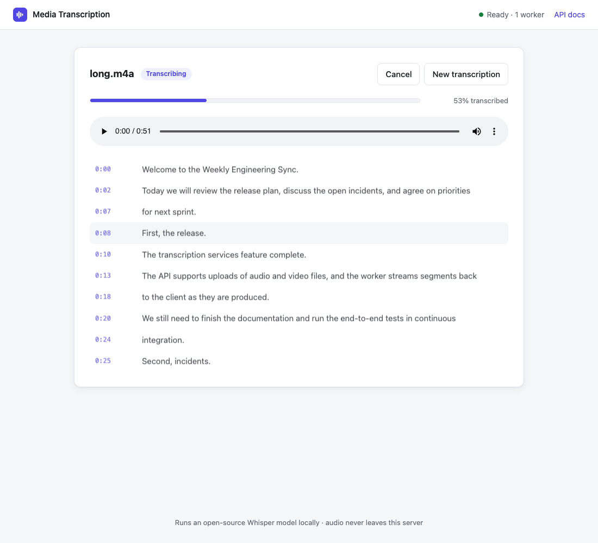

# Media Transcription Service

[](https://github.com/barakrapke/media-transcription-service/actions/workflows/ci.yml)

Upload an audio or video file and get a timestamped transcript. Segments appear live while the
file is being transcribed. Transcription runs locally with an open-source Whisper model from
Hugging Face ([faster-whisper](https://github.com/SYSTRAN/faster-whisper), default
[`Systran/faster-whisper-small`](https://huggingface.co/Systran/faster-whisper-small)).



- **Any media ffmpeg can read**: MP3, WAV, M4A, FLAC, OGG, MP4, MOV, MKV, WebM…
- **Asynchronous jobs** with live progress over Server-Sent Events, or plain polling
- **Web UI**: drag & drop, a live transcript, click a timestamp to jump the player there,
  copy the text, download TXT / SRT / VTT
- **REST API** with OpenAPI docs, a consistent error format and stable error codes
- **Horizontally scalable workers**; a job whose worker dies is re-queued automatically
- **Language auto-detection** (~100 languages) or an explicit language, with optional word timestamps

The design and the reasoning behind every decision are in **[docs/ARCHITECTURE.md](docs/ARCHITECTURE.md)**.

---

## Quickstart

Requirements: Docker with Compose v2. Nothing else is needed on the host.

```sh
git clone https://github.com/barakrapke/media-transcription-service.git
cd media-transcription-service
docker compose up --build        # or: make up
```

Open **http://localhost:8000** and drop in a file. The API docs are at http://localhost:8000/docs.

> The first start downloads the model (~480 MB for `small`) into a Docker volume. The header of
> the UI shows *"Worker starting (loading model)…"* until the worker is ready, which takes 1–2
> minutes depending on your connection. Later starts reuse the cached model and are ready in seconds.

Add workers with `docker compose up -d --scale worker=3`. Stop the stack with `docker compose down`
(add `-v` to also delete the cached model and results).

---

## Using the API

```sh
# 1. Upload. Returns 202 immediately with the job. `language` and `word_timestamps` are optional.
curl -s -F file=@meeting.mp4 -F language=en http://localhost:8000/v1/transcriptions
# {"id":"3f2c…","status":"queued","progress":0.0,"filename":"meeting.mp4",…,"result":null}

# 2a. Follow live progress (Server-Sent Events): status, progress, segment, completed | failed
curl -N http://localhost:8000/v1/transcriptions/3f2c…/events

# 2b. …or poll the job
curl -s http://localhost:8000/v1/transcriptions/3f2c…

# 3. Download the transcript as plain text, SRT or WebVTT
curl -OJ "http://localhost:8000/v1/transcriptions/3f2c…?format=srt"

# 4. Cancel an active job, or delete a finished one and its data
curl -X DELETE http://localhost:8000/v1/transcriptions/3f2c…
```

A completed job:

```json
{
  "id": "3f2c9b…",
  "status": "completed",
  "progress": 1.0,
  "filename": "meeting.mp4",
  "language": "en",
  "word_timestamps": false,
  "created_at": "2026-11-10T09:49:55.997Z",
  "started_at": "2026-11-10T09:49:56.012Z",
  "completed_at": "2026-11-10T09:49:58.611Z",
  "error": null,
  "result": {
    "text": "The quick brown fox jumps over the lazy dog…",
    "language": "en",
    "language_probability": 0.9987,
    "duration": 6.08,
    "model": "Systran/faster-whisper-small",
    "processing_time": 2.6,
    "segments": [
      {"id": 0, "start": 0.0, "end": 6.0, "text": "The quick brown fox jumps over the lazy dog…", "words": null}
    ]
  }
}
```

Every error has the same shape, with a stable `code`:

```json
{"error": {"code": "NO_AUDIO_STREAM", "message": "The file has no audio track.", "request_id": "5c01…"}}
```

| HTTP | Codes |
|---|---|
| 404 | `JOB_NOT_FOUND`, `NOT_FOUND` |
| 409 | `JOB_NOT_COMPLETED` (an export was requested before the job finished) |
| 413 | `FILE_TOO_LARGE` |
| 422 | `INVALID_MEDIA`, `NO_AUDIO_STREAM`, `DURATION_TOO_LONG`, `UNSUPPORTED_LANGUAGE`, `VALIDATION_ERROR` |
| 503 | `QUEUE_FULL`, `DEPENDENCY_UNAVAILABLE` (both with `Retry-After`) |

A job that fails during processing ends in `status: "failed"` with `error.code` set to
`DECODE_ERROR`, `DECODE_TIMEOUT`, `TRANSCRIPTION_ERROR`, `JOB_TIMEOUT` or `WORKER_LOST`.

Health endpoints: `GET /healthz` (liveness) and `GET /readyz` (Redis reachable and at least one
worker alive).

---

## Configuration

All settings are environment variables. They are validated at startup, so an invalid value stops
the service with a clear message. [`.env.example`](.env.example) lists all of them with defaults;
copy it to `.env` to override any. The most useful ones:

| Variable | Default | Description |
|---|---|---|
| `MODEL_NAME` | `Systran/faster-whisper-small` | Any faster-whisper (CTranslate2) model on the Hugging Face Hub |
| `DEVICE` | `auto` | `auto`, `cpu` or `cuda` |
| `COMPUTE_TYPE` | `int8` on CPU, `float16` on CUDA | CTranslate2 quantization |
| `CPU_THREADS` | `0` (auto) | Inference threads per worker |
| `MAX_UPLOAD_MB` | `500` | Upload size limit |
| `MAX_DURATION_SECONDS` | `7200` | Media length limit |
| `MAX_QUEUE_SIZE` | `100` | Pending jobs before uploads get `503 QUEUE_FULL` |
| `JOB_TIMEOUT_SECONDS` | `3600` | Maximum processing time per job |
| `RESULT_TTL_SECONDS` | `86400` | How long finished jobs are kept |
| `MAX_ATTEMPTS` | `2` | Attempts before a job whose worker died is failed |
| `LOG_FORMAT` | `json` in Compose | `json` or `text` |

### Choosing a model

| Model | Size | Notes |
|---|---|---|
| `Systran/faster-whisper-tiny` | 75 MB | Fastest; used by the end-to-end tests |
| `Systran/faster-whisper-small` | 480 MB | **Default.** Good quality on a laptop CPU |
| `Systran/faster-whisper-medium` | 1.5 GB | Better accuracy, slower |
| `Systran/faster-whisper-large-v3` | 3 GB | Best accuracy; GPU recommended |
| `ivrit-ai/whisper-large-v3-ct2` | 3 GB | Fine-tuned for Hebrew |

```sh
MODEL_NAME=Systran/faster-whisper-medium docker compose up -d
```

### GPU

```sh
docker compose -f docker-compose.yml -f docker-compose.gpu.yml up --build
```

This adds the CUDA libraries to the image, reserves an NVIDIA GPU for the worker and defaults to
`large-v3`. It needs the NVIDIA Container Toolkit. **This path is not tested**, because no GPU was
available during development (see [Assumptions](#assumptions-and-trade-offs)).

---

## Development

Requirements: [uv](https://docs.astral.sh/uv/), ffmpeg, Docker (for Redis). Run `make help` to
list all targets.

```sh
make install       # create the virtualenv (Python 3.12) with dev tools
make dev-redis     # Redis in Docker on :6379
make dev-api       # API on http://localhost:8000      (separate terminal)
make dev-worker    # a worker                          (separate terminal)
```

### Tests

```sh
make test          # unit + integration tests with coverage (gate: 80%); needs ffmpeg
make test-docker   # the same, inside Docker: nothing needed on the host
make e2e           # full stack in Docker with the tiny model, then end-to-end tests
make lint          # ruff (lint + format check) and mypy --strict
```

| Layer | What it covers |
|---|---|
| Unit | Formatters, settings validation, ffprobe parsing, filename and language handling, logging, the faster-whisper adapter (with a stubbed model) |
| Integration | The API end to end with a fake transcriber (uploads, validation errors, exports, SSE including replay, cancel and delete, readiness, Redis outage); the worker (success, silence, decode and model errors, timeout, cancellation, recovery of jobs from dead workers); the Redis store's atomic transitions; real ffmpeg decoding |
| End-to-end | The Docker Compose stack with the real `tiny` model: transcribes a speech clip and checks the words, word timestamps, SRT export and deletion |

Unit and integration tests use fakeredis and media files generated with ffmpeg at test time. The
only committed media is a 6-second text-to-speech clip
([tests/fixtures/README.md](tests/fixtures/README.md)).
[CI](.github/workflows/ci.yml) runs lint, the tests and the end-to-end suite on every push.

### Project layout

```
src/transcriber/
├── core/          settings, error model, structured logging
├── jobs/          job model; Redis store (Lua transitions, reliable queue, recovery)
├── media/         upload storage, ffprobe validation, ffmpeg decoding
├── engine/        Transcriber protocol + faster-whisper implementation
├── formatters/    TXT / SRT / VTT export
├── api/           FastAPI app: routes, service layer, SSE, middleware, static UI
└── worker/        job processor, worker loop (heartbeats, sweeper, graceful shutdown)
tests/             unit/, integration/, e2e/, fixtures/
docs/              ARCHITECTURE.md (design + decision record)
```

`api` and `worker` never import each other. Both depend only on the shared packages.

---

## Assumptions and trade-offs

### Assumptions

- **Single tenant on a trusted network**: there is no authentication, no per-user isolation and
  no rate limiting.
- **CPU-only machine.** The defaults (`small`, int8) are chosen so the service is usable on a laptop.
- **Files up to 500 MB / 2 hours.** Longer media is rejected, not split.
- **Transcripts are short-lived.** Finished jobs expire after 24 hours; there is no history.
- **One job per worker process.** Throughput scales by adding workers.
- **Internet access on the worker's first start** to download the model from Hugging Face.

### Shortcuts: what production would use instead

| Here | In production |
|---|---|
| Uploads go through the API onto a shared Docker volume | Object storage (S3/MinIO) with presigned upload URLs, so files never pass through the API |
| Redis is the job store | Postgres for durable job history; Redis only as queue and cache |
| A small custom queue on Redis lists | A managed queue (SQS, RabbitMQ) or Temporal if workflows grow |
| SSE polls Redis on a short interval | Redis pub/sub or streams, to avoid polling per connected client |
| One image for API and worker | A slim API image without the inference stack |
| GPU override not tested | Tested on GPU nodes, autoscaling workers on queue depth (e.g. KEDA) |
| fakeredis in unit and integration tests | testcontainers with real Redis (the E2E suite already uses real Redis) |
| Logs and health checks only | Prometheus metrics (queue depth, latency, failure rate), OpenTelemetry tracing |

### Known limitations

- Starlette buffers the multipart upload to a temporary file before the handler copies it to the
  shared volume, so the API needs temporary disk space for each upload in flight. The size limit
  itself is enforced while the body is still arriving.
- The CTranslate2 inference call cannot be interrupted mid-segment. Cancellation and the job timeout
  take effect at the next segment boundary, usually within a few seconds.
- The media player in the UI works in the tab that uploaded the file. The server never sends the
  media back (it is deleted as soon as the job finishes), so after a refresh or from a shared link
  the UI says so and lets the user pick the file again to play it locally. Nothing is re-uploaded.
- Progress is estimated from the position of the latest segment, so it advances in steps.

### Out of scope / future work

- Speaker diarization (e.g. pyannote; its models are gated on Hugging Face and add a lot of complexity)
- Real-time transcription from a microphone or a live stream
- Ingestion from a URL (YouTube, S3) and resumable uploads
- Splitting very long files across several workers
- Post-processing: inverse text normalization, punctuation restoration, translation
- Job history and transcript editing in the UI
- Load testing and accuracy benchmarks (WER on a reference dataset)
- Hardening for untrusted uploads: ffmpeg parsing hostile files is an attack surface. It is
  mitigated here only by a non-root container and timeouts; production would sandbox decoding
  (seccomp, no network, a separate container) and scan uploads.

---

## Troubleshooting

- **The UI says "Worker starting" for a long time.** The model is still downloading. Run
  `docker compose logs -f worker`.
- **Model download fails with a certificate error.** This happens on networks whose proxy inspects
  HTTPS traffic. Mount the proxy's CA bundle into the worker and set `SSL_CERT_FILE` /
  `REQUESTS_CA_BUNDLE` to it. If the download still stalls, also set `HF_HUB_DISABLE_XET=1`.
- **Port 8000 is taken.** Run `API_PORT=8080 docker compose up -d`.

## License

[MIT](LICENSE)
